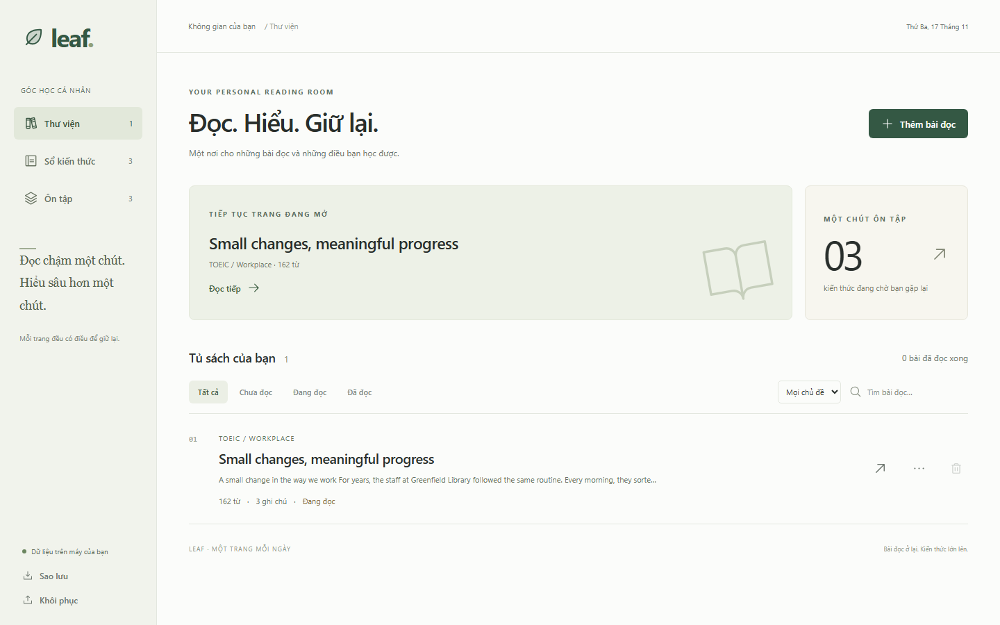
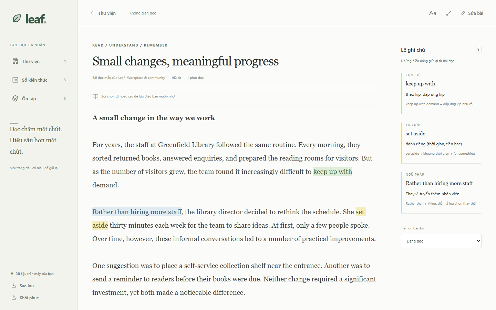

# Leaf — Góc đọc cá nhân

[](https://github.com/binhtoong21/leaf-reading/actions/workflows/ci.yml)
[](https://github.com/binhtoong21/leaf-reading/releases/latest)
[](LICENSE)

> **English:** Leaf is a local-first reading notebook for Vietnamese learners of English (TOEIC). Read passages,
> highlight words, phrases and grammar, write notes in your own words and review them as flashcards with their
> original context. Optional AI lookup works with any OpenAI-compatible API. The interface is in Vietnamese.
> Windows installer: see [Releases](https://github.com/binhtoong21/leaf-reading/releases/latest). License: MIT.

Leaf là nơi đọc bài tiếng Anh và giữ lại những gì bạn học được từ đó. Dán bài đọc, highlight từ vựng, cụm từ, ngữ
pháp, ghi lại cách hiểu bằng lời của mình, rồi ôn lại bằng thẻ ghi nhớ, luôn kèm câu gốc chứa nó. App được làm cho
người Việt luyện TOEIC.

Mọi dữ liệu nằm trên máy bạn: không cần tài khoản, không lên cloud, chỉ một file SQLite.




## Tính năng

- **Thư viện** bài đọc, có thẻ chủ đề, nguồn và tiến độ đọc.
- **Đọc bài** với highlight theo màu (từ vựng, cụm từ, ngữ pháp, ghi chú), lề ghi chú, chế độ tập trung, đổi cỡ chữ.
- **Sổ kiến thức** tìm lại mọi thứ đã lưu và quay về đúng chỗ trong bài gốc.
- **Ôn tập** bằng thẻ che nghĩa, hiện kèm ngữ cảnh, theo lịch lặp lại ngắt quãng đơn giản.
- **Tra từ bằng AI (tùy chọn):** chọn từ hoặc cụm từ để xem nghĩa theo ngữ cảnh, phát âm, họ từ, ví dụ, từ dễ nhầm,
  rồi sửa lại và lưu thành ghi chú. Dùng được với mọi nhà cung cấp chuẩn OpenAI (Gemini, OpenRouter, Ollama…).
- **Sao lưu / khôi phục** toàn bộ thư viện bằng một file JSON.

## Cài đặt (Windows)

1. Tải `Leaf-Setup-<phiên bản>.exe` ở mục [Releases](https://github.com/binhtoong21/leaf-reading/releases/latest).
2. Chạy file vừa tải. Windows SmartScreen có thể cảnh báo vì file cài chưa được ký số: chọn **More info → Run anyway**.
3. Leaf được cài cho tài khoản hiện tại, có shortcut **Leaf** ngoài Desktop và trong Start menu. Gỡ trong
   *Settings → Apps* như app bình thường.

App lưu dữ liệu ở `%APPDATA%\Leaf\leaf.sqlite`. Gỡ app không xóa dữ liệu này. Cài bản mới đè lên bản cũ vẫn giữ nguyên dữ liệu.

## Chạy từ mã nguồn

Cần [Node.js](https://nodejs.org/) **22.13 trở lên** (khuyên dùng Node 24 LTS). Node 22 có thể in cảnh báo
"SQLite is experimental", không phải lỗi. Trên Windows dùng `npm.cmd` để PowerShell không chặn `npm.ps1`.

```powershell
git clone https://github.com/binhtoong21/leaf-reading.git
cd leaf-reading
npm.cmd install
```

| Lệnh | Tác dụng |
|---|---|
| `npm.cmd run dev` | Chế độ phát triển: API cổng 4318 + Vite tại **http://127.0.0.1:5173**, tự tải lại khi sửa code |
| `npm.cmd run build` rồi `npm.cmd start` | Bản build, mở **http://127.0.0.1:4318** |
| `npm.cmd run app` | Build rồi mở cửa sổ app desktop, không cần cài |
| `npm.cmd run dist` | Tạo file cài Windows trong thư mục `release/` |
| `npm.cmd test` | Chạy test |

Bản chạy trong trình duyệt lưu dữ liệu ở `data/leaf.sqlite` trong thư mục dự án, tách riêng với app desktop. Hai bản
cùng dùng cổng 4318 nên chỉ chạy được một bản mỗi lúc. Muốn chuyển dữ liệu: **Sao lưu** ở bản này, **Khôi phục** ở bản kia.

## Tra từ bằng AI (tùy chọn)

Leaf gọi được mọi nhà cung cấp hỗ trợ chuẩn OpenAI `/chat/completions`. Cấu hình nằm trong file `.env`:

- app desktop: `%APPDATA%\Leaf\.env`
- chạy từ mã nguồn: `.env` trong thư mục dự án (sao chép từ `.env.example`)

Ví dụ với Google Gemini (lấy API key miễn phí ở [aistudio.google.com](https://aistudio.google.com)):

```
LOOKUP_BASE_URL=https://generativelanguage.googleapis.com/v1beta/openai
LOOKUP_API_KEY=<key của bạn>
LOOKUP_MODEL=gemini-3.5-flash-lite
LOOKUP_FALLBACK_MODELS=gemini-3.1-flash-lite
```

Khởi động lại Leaf sau khi sửa `.env`. Các tùy chọn khác có giải thích trong [`.env.example`](.env.example).

- Key chỉ nằm trong `.env` trên máy bạn, không gửi xuống giao diện, không có trong file sao lưu.
- Chỉ gửi cụm đã chọn (tối đa 200 ký tự) và câu chứa nó, không gửi cả bài. Gói miễn phí (ví dụ Gemini) có thể dùng
  dữ liệu gửi lên để cải thiện sản phẩm, nên đừng tra từ trong tài liệu riêng tư.
- Kết quả được lưu cache trên máy (tối đa 2.000 mục): tra lại cùng chỗ không tốn lượt và xem được khi mất mạng.
- Khi model chính quá tải (503) hoặc hết lượt (429), Leaf chuyển sang `LOOKUP_FALLBACK_MODELS`. Tổng thời gian chờ tối đa 20 giây.
- Tối đa `LOOKUP_DAILY_LIMIT` lượt gọi AI mỗi ngày (mặc định 100).
- Nội dung AI có thể sai: bạn luôn xem và sửa trước khi lưu.

Chưa cấu hình thì nút Tra từ báo rõ và gợi ý ghi chú thủ công.

## Cách dùng

1. **Thêm bài đọc:** dán văn bản, đặt tiêu đề, nguồn và thẻ chủ đề. Có sẵn một bài mẫu để thử.
2. **Highlight:** bôi chọn từ hoặc câu, chọn **Ghi chú & highlight**, chọn loại và ghi cách hiểu của bạn. Hoặc chọn
   **Tra từ** để hỏi AI, rồi **Lưu ghi chú…** để mở form đã điền sẵn, sửa lại và lưu.
3. Nhấn vào highlight hoặc ghi chú ở lề để sửa hoặc xóa. Các highlight không chồng lên nhau. Bài đã có highlight sẽ
   khóa sửa nội dung để giữ đúng vị trí; tiêu đề, nguồn và thẻ vẫn sửa được.
4. **Sổ kiến thức** tìm theo từ, nghĩa và giải thích; quay lại bài gốc bất cứ lúc nào.
5. **Ôn tập** hiện các thẻ đến hạn kèm ngữ cảnh. Chưa nhớ → 10 phút; hơi khó → ít nhất 1 ngày; đã nhớ → ít nhất
   1 ngày, sau đó nhân 2,5; rất dễ → ít nhất 4 ngày, sau đó nhân 4; tối đa 365 ngày. Ghi chú thường không vào ôn tập.
6. **Sao lưu** xuất file JSON; **Khôi phục** thay toàn bộ thư viện sau khi xác nhận. Nên sao lưu bản hiện tại trước khi khôi phục.

## Dữ liệu, quyền riêng tư và giới hạn

- Server chỉ lắng nghe `127.0.0.1` và kiểm tra Host/Origin; API tra từ cần thêm token sinh mỗi lần chạy. Không thiết
  kế để đưa lên internet hay cho nhiều người dùng chung.
- Dữ liệu không mã hóa, được bảo vệ bởi tài khoản Windows của bạn.
- Chỉ nhập bài dạng văn bản: chưa trích xuất PDF, OCR hay tự tải trang web.
- Request tối đa 12 MB; mỗi bài tối đa 500.000 ký tự, 30 thẻ, mỗi thẻ tối đa 80 ký tự.
- Thư viện lưu thành một bản snapshot đã kiểm tra toàn vẹn trong SQLite, phù hợp thư viện cá nhân.

## Cấu trúc

```text
src/                Giao diện React (components, features, lib)
server/
  index.mjs         API local và phục vụ bản build (startServer)
  store.mjs         Lưu trữ SQLite, kiểm tra dữ liệu, lịch ôn
  lookup.mjs        Tra từ bằng AI: prompt, gọi nhà cung cấp, thử lại/dự phòng, cache, giới hạn lượt
  dev.mjs           Chạy API và Vite cùng lúc
electron/main.mjs   Vỏ app desktop: chạy server bên trong và mở cửa sổ
build/              Icon app (sửa icon.svg rồi chạy `npm.cmd run icon`)
tests/              Test bằng Node test runner
docs/               Định hướng sản phẩm và ảnh chụp màn hình
```

## Phát hành bản mới

Đẩy một tag `v<phiên bản>` trùng với `version` trong `package.json` thì GitHub Actions tự build file cài Windows và
đăng lên mục Releases:

```powershell
npm.cmd version patch   # tăng phiên bản trong package.json và tạo tag, ví dụ v1.0.1
git push origin main --follow-tags
```

## Giấy phép

[MIT](LICENSE)
